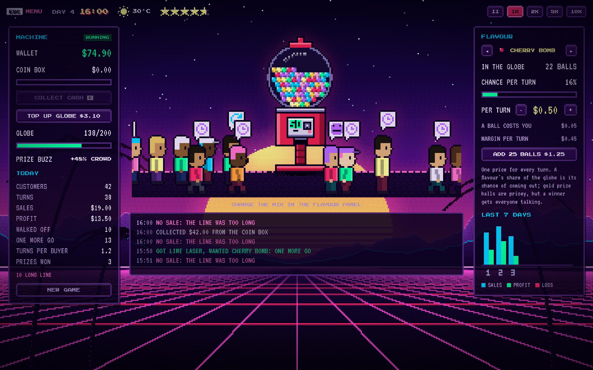
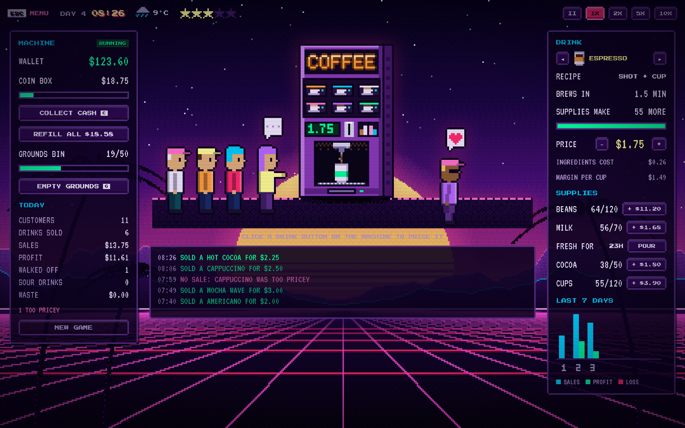
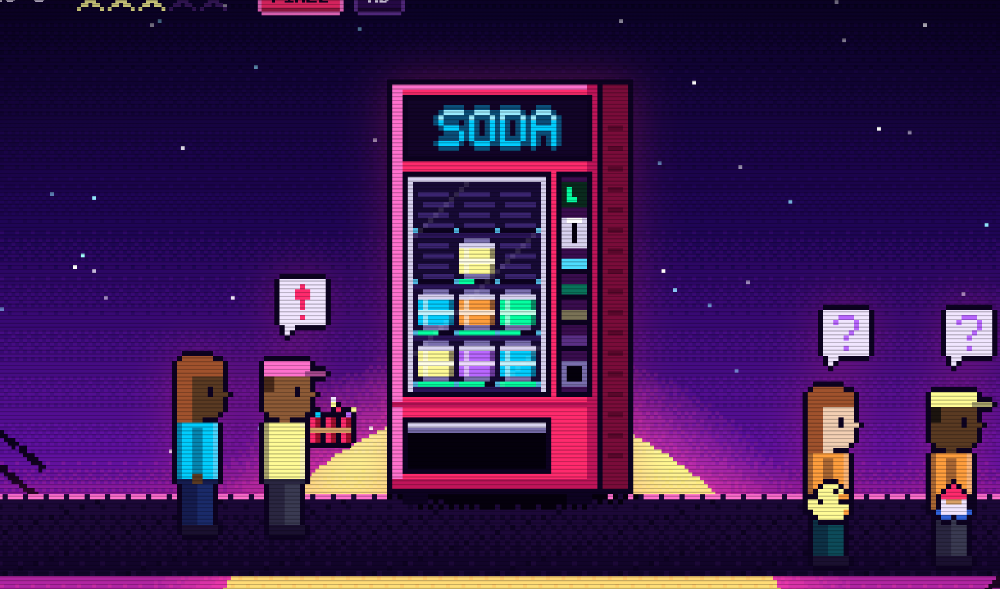
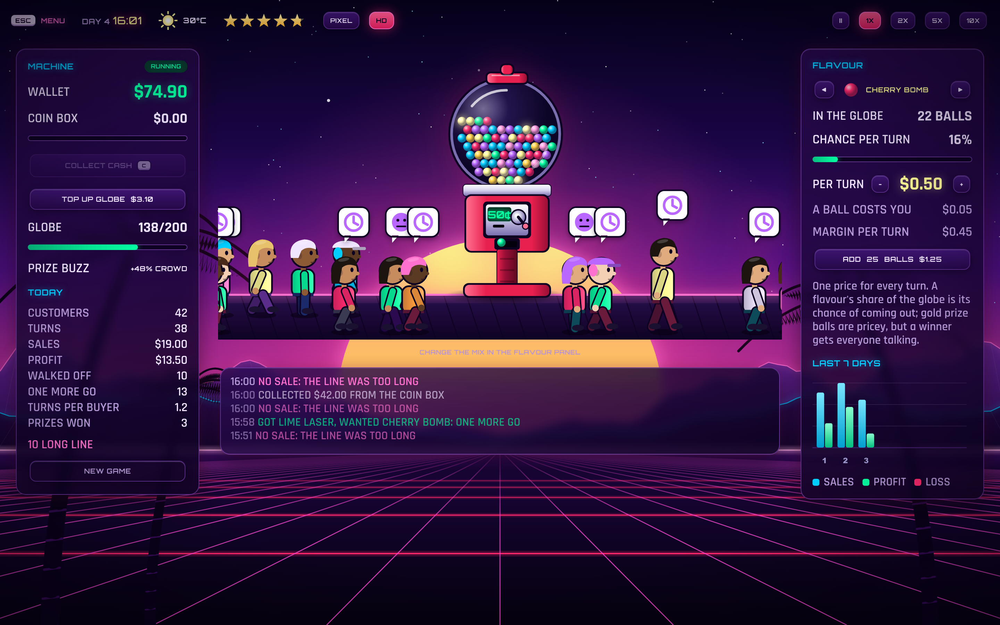

# Vending Tycoon — a vending machine simulator

**Try it live: [clayhill.github.io/vending-tycoon](https://clayhill.github.io/vending-tycoon/)**


A vending machine simulator that runs in your browser, styled as a vaporwave arcade game:
neon grids, sunsets and crisp, high-resolution pixel art. Pick a machine on the launch page and
step up to it.

## Soda Cans

The first machine. You run a soda can vending machine on a neon street:


- **Customers** come by more at lunch and in the evening, on hot days and when your star rating is high.
  Each wants a favourite drink and will pay up to a price of their own; they queue, buy it, settle for
  another drink, or walk off (sold out, too pricey, a jammed machine, a line too long). A bubble over
  their head says which.
- **You** set each slot's price, swap its drink, restock it, empty the coin box before it fills up
  (a full box refuses coins) and pay to fix the occasional coin jam. Rent is due every midnight.
- **Keys:** arrows pick a slot, `+`/`-` price, `R` restock, `C` collect, space pauses, `1`–`4` speed.

## Snacks

Twenty spiral coils of chips, bars, cookies, pretzels, gummies and nuts, with two problems the cans
don't have:


- **Shelf life.** Every snack has a best-before date, from a week for cookies to two months for nuts.
  Stale snacks still sell, but the buyer is disgusted and the rating takes a hit; bin them (`B`) and
  the cost is written off as waste.
- **Stuck snacks.** Now and then a snack hangs in its coil after the customer paid, and they leave
  angry; the next buyer from that coil gets two for one. The coils wear a little every day and stick
  more often until you pay for a service (`S`).
- Customers buy snacks most in the afternoon and late at night, a little more on cold days.

## Gumballs

One glass globe of 200 gumballs, one price per turn, and a crowd of kids after school. Nobody picks a
flavour: a turn of the crank hands out a random ball, so the mix in the globe is the whole game.



- **The mix.** Each flavour's share of the globe is its chance of coming out. A kid whose favourite
  colour is missing may not bother, and one who gets the wrong colour often goes again.
- **Prize balls.** Gold prize balls cost far more than a gumball, but every one that comes out gets
  the neighbourhood talking, and the buzz brings in a bigger crowd for the next few days.
- **Top up the globe** to share its free space among the flavours, or add one flavour at a time.

## Coffee

Six hot drinks brewed to order from one set of supplies: beans, milk, cocoa and cups. Each drink has
its own recipe and price, and a brew takes a few minutes while the customer waits, so the morning
commute builds a line.



- **Shared supplies.** A latte takes a shot and two cups of milk; a hot cocoa takes no beans at all.
  Running out of one supply stops every drink that needs it. Refill one supply or everything.
- **Sour milk.** Milk keeps for two days after you fill an empty tank, and topping it up keeps the
  old date. A drink made with sour milk disgusts its buyer; pour the milk away (`B`) and it counts as
  waste.
- **The grounds bin.** Every shot leaves a puck of grounds. When the bin is full the machine stops
  until you empty it (`G`).
- Cold and rainy days bring more customers, who pay more; the kiosk's rent is the highest of all.

## Things that should not come out of a vending machine

About one sale in forty, a machine drops something else instead of the product: a rubber duck, a
wet fish, an old boot, a mixtape, a tiny cactus, a garden gnome. The customer is puzzled, but it was
paid for. About one of those in eight is a bundle of TNT with wires and a lit fuse, which works out
at roughly one explosion every two game weeks. TNT only comes out when you could pay for a new
machine, and never twice within three days. The game drops to normal speed so you see it coming. The customer picks it up, the fuse burns down, and the machine
explodes, taking its stock and the coin box with it. The smoking wreck sells nothing: order a new
machine (`O`). It arrives filled, a couple of game hours later.



## Pixel or HD

The switch at the top of every page picks how it is drawn: **PIXEL**, the low-resolution pixel art
scaled up crisp, or **HD**, the same street, machines and customers redrawn as smooth vector art at
your screen's full resolution, with glass panels and clean type. Your choice is remembered in this
browser.



## How it's built

Every machine runs on one engine, `js/vend/`: the simulation, the customers and the game screen. A
machine adds its config (`js/soda/config.js`, `js/snack/config.js`, `js/gumball/config.js`, `js/coffee/config.js`) and its pixel art
(`js/machines.js`, and `js/machines-hd.js` for HD; the HD backdrop, customers and icons are in `js/hd.js`; the oddities, the explosion and the wreck in `js/boom.js`). The simulation runs without the page, so `npm test` plays a month of each machine
in Node and checks that the money adds up. Games save themselves in your browser.

## Running it

It is a static site with no build step. Open `index.html`, or serve the folder:

```bash
python3 -m http.server 8000
```

GitHub Pages publishes the `main` branch as it is.
