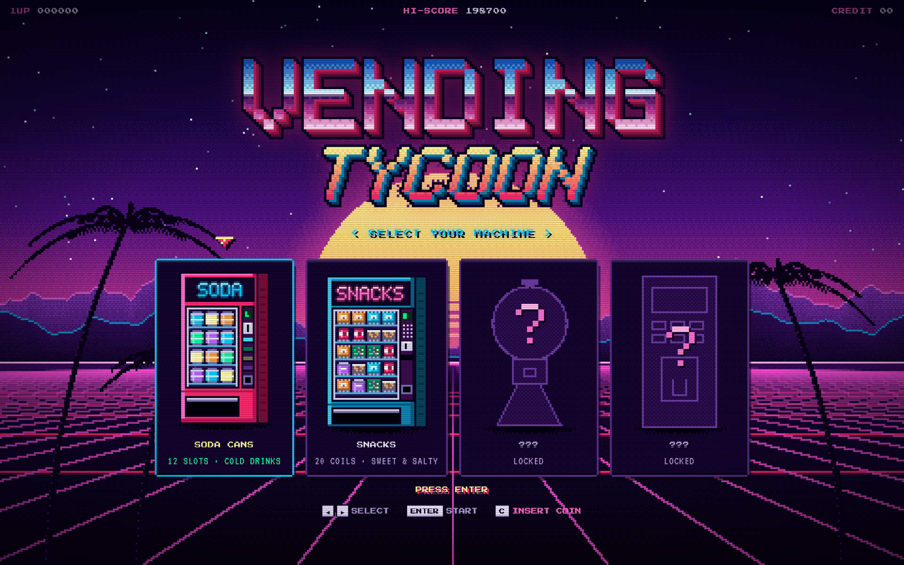
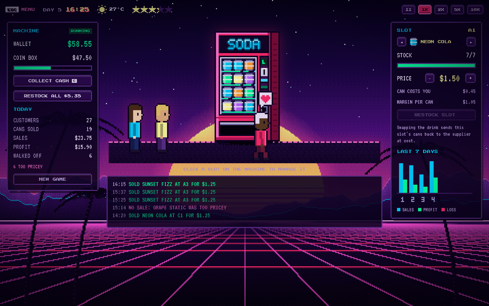
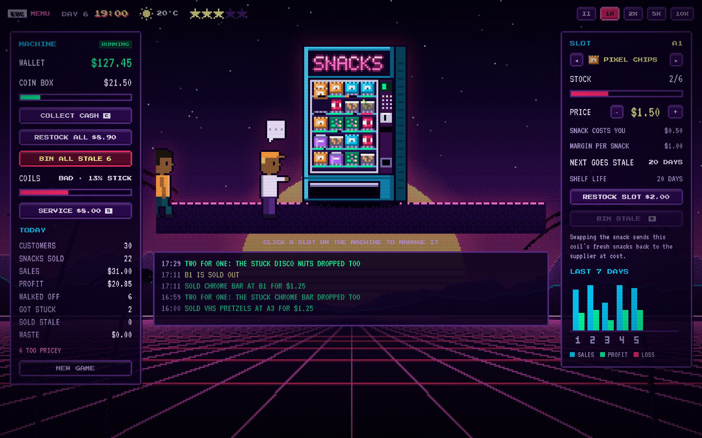

# Vending Tycoon — a vending machine simulator

**Try it live: [clayhill.github.io/vending-tycoon](https://clayhill.github.io/vending-tycoon/)**



A vending machine simulator that runs in your browser, styled as a vaporwave arcade game:
neon grids, sunsets and crisp, high-resolution pixel art. Pick a machine on the launch page and
step up to it.

## Soda Cans

The first machine. You run a soda can vending machine on a neon street:



- **Customers** come by more at lunch and in the evening, on hot days and when your star rating is high.
  Each wants a favourite drink and will pay up to a price of their own; they queue, buy it, settle for
  another drink, or walk off (sold out, too pricey, a jammed machine, a line too long). A bubble over
  their head says which.
- **You** set each slot's price, swap its drink, restock it, empty the coin box before it fills up
  (a full box refuses coins) and pay to fix the occasional coin jam. Rent is due every midnight.
- **Keys:** arrows pick a slot, `+`/`-` price, `R` restock, `C` collect, space pauses, `1`–`4` speed.

## Snacks

Twenty spiral coils of chips, bars, cookies, pretzels, gummies and nuts, with two problems the cans
don't have:



- **Shelf life.** Every snack has a best-before date, from a week for cookies to two months for nuts.
  Stale snacks still sell, but the buyer is disgusted and the rating takes a hit; bin them (`B`) and
  the cost is written off as waste.
- **Stuck snacks.** Now and then a snack hangs in its coil after the customer paid, and they leave
  angry; the next buyer from that coil gets two for one. The coils wear a little every day and stick
  more often until you pay for a service (`S`).
- Customers buy snacks most in the afternoon and late at night, a little more on cold days.

## How it's built

Every machine runs on one engine, `js/vend/`: the simulation, the customers and the game screen. A
machine adds its config (`js/soda/config.js`, `js/snack/config.js`) and its pixel art
(`js/machines.js`). The simulation runs without the page, so `npm test` plays a month of each machine
in Node and checks that the money adds up. Games save themselves in your browser.

## Running it

It is a static site with no build step. Open `index.html`, or serve the folder:

```bash
python3 -m http.server 8000
```

GitHub Pages publishes the `main` branch as it is.
